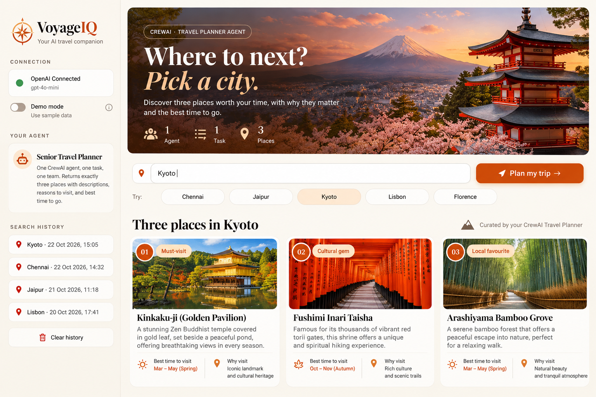
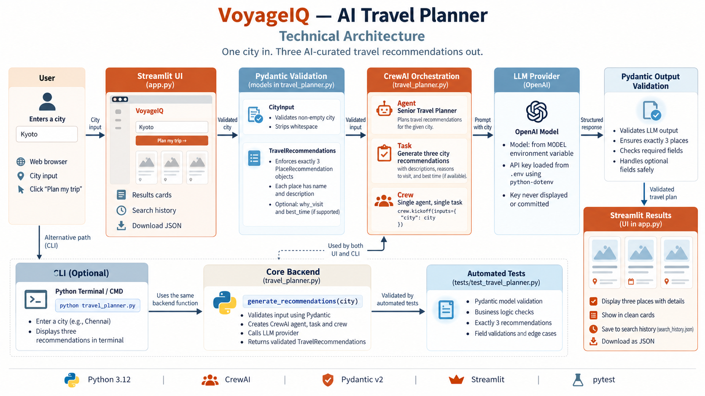

# VoyageIQ — AI Travel Planner

> **One city in. Three AI-curated travel recommendations out.**

VoyageIQ is a Python application that uses CrewAI to recommend three places to visit in a city. It combines a Streamlit interface with a reusable CrewAI backend, Pydantic validation, and automated tests. A command-line interface is also available for the original assignment workflow.

## Project at a glance

- **User interface:** Streamlit
- **Agent orchestration:** CrewAI — one agent, one task, one crew
- **Data validation:** Pydantic v2
- **LLM integration:** OpenAI-compatible model configured through environment variables
- **Configuration:** `python-dotenv`
- **Automated testing:** `pytest`
- **Python:** Python 3.12 recommended for this project setup

## Screenshots and diagrams

### Application design



### Technical architecture



### Running application

A screenshot of the actual running app can be added later. Save it as `assets/app-screenshot.png`, then uncomment this line:

<!--  -->

## Features

- Accepts a city name from the user.
- Uses a CrewAI Travel Planner agent with a defined role, goal, and backstory.
- Executes one task through one crew using `crew.kickoff(inputs={"city": city})`.
- Uses Pydantic models to validate city input and structured recommendation output.
- Enforces exactly three recommendations.
- Displays recommendations in a styled Streamlit interface.
- Supports search history and JSON download in the UI.
- Provides a command-line interface using the same backend function.
- Loads credentials from a local `.env` file rather than hard-coding API keys.
- Includes automated tests for validation behavior.

> **Accuracy note:** Unless a live travel-data tool is added, recommendations are generated by the configured language model. Opening hours, prices, availability, and other time-sensitive details are not independently verified.

## Architecture

```text
User
 ├── Streamlit UI (app.py)
 │    ├── City input and suggested cities
 │    ├── Recommendation cards
 │    ├── Search history
 │    └── JSON download
 │
 └── CLI (travel_planner.py)
       │
       ▼
   Shared backend: generate_recommendations(city)
       │
       ├── CityInput (Pydantic validation)
       ├── CrewAI Agent: Experienced Travel Planner
       ├── CrewAI Task: recommend exactly three places
       ├── Crew: one agent + one task
       ├── Configured LLM / OpenAI API
       └── TravelRecommendations (Pydantic validation)
                    │
                    ▼
          Three structured recommendations

Automated tests: tests/test_travel_planner.py
```

## Project structure

```text
travel-planner-agent/
├── app.py                         # Streamlit UI
├── travel_planner.py              # CrewAI backend, Pydantic models, CLI
├── streamlit_app.py               # Optional Streamlit launcher
├── requirements.txt               # Python dependencies
├── .env.example                   # Environment-variable template
├── .gitignore                     # Excludes secrets and generated files
├── assets/
│   ├── design.png                 # UI design reference
│   ├── architecture.png           # Technical architecture diagram
│   └── app-screenshot.png         # Optional real app screenshot
├── .streamlit/
│   └── config.toml                # Streamlit appearance configuration
├── tests/
│   └── test_travel_planner.py     # Automated tests
└── docs/                          # Additional project documentation
```

The `.env` file is created locally and must not be committed. `search_history.json` may be generated by the UI at runtime; review its contents before committing or sharing it. The `.venv` virtual environment is intentionally stored one level above this project folder and is not part of the repository.

## Prerequisites

- Windows, macOS, or Linux
- Python 3.12 recommended
- An OpenAI API key with access to the configured model
- Internet access for LLM API requests

## Setup on Windows

Commands below assume the project is located at:

```text
D:\!Social Eagle AI\Social Eagle Labs\travel-planner-agent
```

The virtual environment is expected at the parent level:

```text
D:\!Social Eagle AI\Social Eagle Labs\.venv
```

### 1. Open the project folder

```cmd
cd /d "D:\!Social Eagle AI\Social Eagle Labs\travel-planner-agent"
```

### 2. Install dependencies into the existing parent environment

```cmd
..\.venv\Scripts\python.exe -m pip install -r requirements.txt
```

### 3. Configure environment variables

Create or update `.env` in the project root. Use `.env.example` as a template.

```dotenv
OPENAI_API_KEY=your_actual_api_key
MODEL=openai/gpt-4o-mini
```

Replace the placeholder locally. Never paste the key into source code, screenshots, or public repositories. Ensure `.env` is excluded by `.gitignore`.

The configured model must be available to your API account. If you use a different supported model, update `MODEL` accordingly.

## Run the application

### Streamlit UI

```cmd
..\.venv\Scripts\python.exe -m streamlit run app.py
```

Open the local URL printed by Streamlit, usually `http://localhost:8501`.

### Command-line interface

```cmd
..\.venv\Scripts\python.exe travel_planner.py
```

Enter a city when prompted. The CLI and Streamlit UI use the same backend function.

### Optional launcher

If you prefer the compatibility launcher:

```cmd
..\.venv\Scripts\python.exe -m streamlit run streamlit_app.py
```

## Validation and tests

- **Test framework:** `pytest`
- **Recorded result:** 10 passed
- **Status:** All listed automated validation tests passed in the recorded run.

The recorded test output was:

```text
tests/test_travel_planner.py::test_city_name_is_trimmed PASSED
tests/test_travel_planner.py::test_blank_city_is_rejected PASSED
tests/test_travel_planner.py::test_three_recommendations_are_accepted PASSED
tests/test_travel_planner.py::test_two_recommendations_are_rejected PASSED
tests/test_travel_planner.py::test_four_recommendations_are_rejected PASSED
tests/test_travel_planner.py::test_empty_place_name_is_rejected PASSED
tests/test_travel_planner.py::test_empty_description_is_rejected PASSED
tests/test_travel_planner.py::test_duplicate_places_are_rejected PASSED
tests/test_travel_planner.py::test_travel_plan_has_exactly_three_places PASSED
tests/test_travel_planner.py::test_travel_plan_rejects_blank_city PASSED

10 passed in 1.01s
```

Run the tests again in your current environment before relying on this result:

```cmd
..\.venv\Scripts\python.exe -m pytest tests -v
```

### Syntax check

```cmd
..\.venv\Scripts\python.exe -m py_compile travel_planner.py app.py streamlit_app.py
```

Tests cover city input trimming, blank input rejection, acceptance of exactly three recommendations, rejection of two or four recommendations, required place fields, duplicate-place validation, and travel-plan validation. The tests should run without making live OpenAI calls.

## Pydantic models

- `CityInput` validates that the city is a non-empty string and trims surrounding whitespace.
- `PlaceRecommendation` requires a non-empty name and description.
- `TravelRecommendations` requires exactly three recommendation objects.

Pydantic validates structure and constraints; it does not independently confirm that a city exists, correct misspellings, or verify that an attraction belongs to that city.

## Troubleshooting

### `OPENAI_API_KEY` is missing

- Check that `.env` is in the project root.
- Confirm the variable is named `OPENAI_API_KEY`.
- Restart Streamlit after changing environment variables.
- Never print or share the actual key while debugging.

### Model or API errors

- Check internet connectivity and API account access.
- Confirm the `MODEL` value is supported by your account.
- Review the terminal for the underlying error, but do not share secrets.

### Streamlit cannot import a function

- Confirm `app.py` and `travel_planner.py` are in the same project folder.
- Confirm the expected function is present in `travel_planner.py`.
- Stop the running Streamlit process with `Ctrl+C` and restart it.

### Tests fail

```cmd
..\.venv\Scripts\python.exe -m pytest tests -v
```

Use the first failing test and its traceback to identify the issue before changing the application code.

## Security and repository hygiene

- Do not commit `.env`, API keys, or other credentials.
- Keep `.env.example` free of real secrets.
- Do not include virtual environments, caches, or generated logs in Git.
- Review search-history data before committing if it may contain personal information.
- Use only verified screenshots and diagrams in the documentation.

## Current scope and future enhancements

**Current scope**
- One CrewAI agent
- One CrewAI task
- One Crew
- Pydantic input and output validation
- Streamlit UI and CLI
- Automated validation tests

**Possible future enhancements**
- Optional city-name correction with user confirmation
- Verified attraction data from a trusted travel API
- More granular API error messages
- Additional tests for CrewAI failures and UI workflows
- Deployment with secure environment-variable management

## Assignment workflow

The original assignment workflow is preserved:

1. Ask the user for a city.
2. Define one agent with role, goal, and backstory.
3. Define one task with an expected output.
4. Assemble one crew.
5. Execute `crew.kickoff(inputs={"city": city})`.
6. Display three recommendations.

## License

Add a license before distributing this project publicly. Until then, no open-source license is specified.
